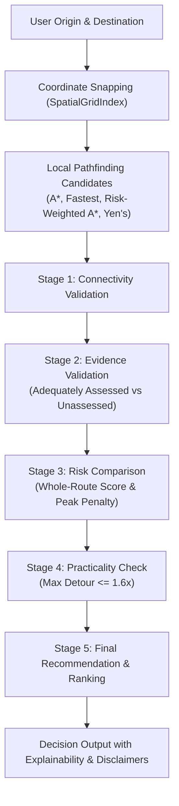

# RAAHI — Offline AI Safe Route Decision System

## 1. System Overview

RAAHI is a self-contained, fully offline, risk-aware route decision engine designed for informed pedestrian journey planning. Unlike conventional navigation services that focus solely on shortest physical distance or travel time, RAAHI balances distance, duration, available risk observations, and evidence completeness to recommend the lowest-assessed-risk viable route while providing transparent explainability.

**Primary Principle:** Zero network API dependency. All route calculations, spatial indexing, pathfinding algorithms, risk scoring, ML inference, and decision evaluations run directly inside the local application runtime using local data and local code.

---

## 2. Zero Network API Dependency

The system operates strictly without external cloud services or network routing APIs:

- **No** Google Maps / Google Routes / Google Places
- **No** Mapbox Directions / MapTiler
- **No** OSRM / Valhalla / GraphHopper hosted or remote routing servers
- **No** Overpass / Nominatim public endpoints
- **No** Gemini / OpenAI / cloud AI APIs
- **No** External CDNs at runtime

---

## 3. Offline Road Network Graph & Spatial Indexing

The road network is represented as a directed graph $G = (V, E)$:

- **Nodes ($V$):** Road intersections and connection points with latitude, longitude, and geographic tags.
- **Edges ($E$):** Traversable road segments containing start node, end node, length in kilometers, estimated walking speed (default 4.5 km/h), road classification (`footway`, `pedestrian`, `residential`, `secondary`, `primary`, etc.), one-way restrictions, GeoJSON polyline geometry, and metadata.
- **Spatial Grid Index (`SpatialGridIndex`):** Pure-Python 2D spatial hash grid (cell size $\approx 0.01^\circ \approx 1.1\text{ km}$) for coordinate-to-node snapping with configurable maximum distance cutoffs (default 3.0 km).
- **OSM Preprocessing Pipeline (`convert_osm_pbf_to_graph`):** Ingests raw `.osm.pbf` dumps using `osmium.SimpleHandler`, extracts pedestrian-traversable ways, respects `oneway` and `access` tags, computes Haversine segment lengths, and serializes compact graph JSON files.

---

## 4. Five Local Pathfinding Algorithms

All graph search algorithms are implemented directly in `backend/app/pathfinding.py`:

| Algorithm | Role & Purpose | Key Properties |
|---|---|---|
| **1. Dijkstra** | Baseline shortest path | Priority queue (`heapq`) handling non-negative edge weights; benchmark for algorithm correctness. |
| **2. A\*** | Goal-directed shortest path | Uses admissible and consistent Haversine heuristic ($h(u, \text{target}) \le \text{dist}(u, \text{target})$). Proved optimal against Dijkstra. |
| **3. Yen's $K$-Shortest Paths** | Candidate alternative generation | Generates top $K$ loopless simple paths using spur node deviations and edge masking; guarantees no duplicate or circular paths. |
| **4. Risk-Weighted A\*** | Risk-averse candidate discovery | Optimizes cost function $\text{edge\_cost} = \text{distance} \times \left(1 + \lambda \times \frac{\text{normalized\_risk}}{100}\right)$ with risk aversion $\lambda \in [0.8, 1.5, 2.5]$. Admissible heuristic preserved. |
| **5. Diversity Filtering** | Overlap & detour filtering | Computes edge-sharing ratio $\frac{\text{shared\_km}}{\min(L_1, L_2)}$. Rejects candidates with overlap $> 75\%$ or circuitous detours $> 1.6\times$ shortest distance. |

**Candidate Generation Strategy:**
1. Shortest distance (A* / Dijkstra)
2. Fastest travel (travel minutes)
3. Risk-weighted A* across multiple aversion values ($\lambda = 0.8, 1.5, 2.5$)
4. Yen's $K$-shortest simple paths ($K = 5$)
5. Deduplicate and filter diverse alternatives.

---

## 5. Exact Safety Risk Scoring Engine

Implemented strictly in `backend/app/raahi_risk_engine.py` following `raahi_config.json`:

### Risk Parameters & Weights

$$\text{Total Configured Weight} = 0.90$$

| Parameter | Weight |
|---|---:|
| Incident risk | 0.25 |
| Report freshness | 0.15 |
| Population/foot traffic risk | 0.10 |
| Lighting risk | 0.10 |
| Time-of-day risk | 0.10 |
| Historical risk | 0.10 |
| Isolation risk | 0.10 |

### Segment Scoring & Confidence

$$\text{segment\_score} = \frac{\sum (w_i \times x_i)}{\sum w_i}$$

$$\text{coverage} = \sum w_i \quad (\text{range } 0.0 \text{ to } 0.90)$$

$$\text{confidence} = \text{round}\Big(100 \times \text{coverage} \times (0.35 + 0.65 \times \text{corroboration})\Big)$$

*Note:* Missing inputs remain missing and are never substituted with zero.

### Classifications

- **GREEN (Lower reported risk):** $\text{score} < 35$
- **YELLOW (Moderate reported risk):** $35 \le \text{score} < 65$
- **RED (Higher reported risk):** $\text{score} \ge 65$
- **GREY (Insufficient evidence):** $\text{coverage} < 0.40 \text{ OR } \text{confidence} < 35$ (or unassessed)

### Whole-Route Scoring

$$\text{weighted\_average} = \frac{\sum (\text{stretch\_length} \times \text{stretch\_score})}{\sum \text{scored\_stretch\_lengths}}$$

$$\text{route\_score} = 0.70 \times \text{weighted\_average} + 0.30 \times \max(\text{stretch\_scores})$$

$$\text{route\_confidence} = \text{round}\left(\frac{\sum (\text{stretch\_length} \times \text{stretch\_confidence})}{\sum \text{scored\_stretch\_lengths}}\right)$$

$$\text{assessed\_distance\_ratio} = \frac{\sum \text{scored\_lengths}}{\text{total\_route\_length}}$$

If no scored stretches exist, or $\text{route\_confidence} < 35$, or $\text{assessed\_distance\_ratio} < 30\%$, the route is classified as **GREY / INSUFFICIENT**.

---

## 6. Two Distinct Modes

- **Mode A — Synthetic Demonstration:**
  - Uses the 12-file package (`raahi_stretches.csv`, `road_network.csv`, `cctv_coverage.csv`, `traffic_data.csv`, `street_lighting.csv`, etc.).
  - Evaluates scores across all 4 time bands (`morning`, `day`, `evening`, `night`).
  - Labeled: `SYNTHETIC DEMONSTRATION — NOT REAL SAFETY INFORMATION`.
- **Mode B — Actual Offline Road Routing:**
  - Real offline OpenStreetMap road network covering central Delhi corridors (Connaught Place, Barakhamba, Janpath, KG Marg, Kartavya Path, India Gate).
  - Strictly separated: Real roads are never assigned synthetic scores.
  - Classifies real corridors as **GREY / UNASSESSED** until verified $k$-anonymized community reports ($k \ge 3$) are linked.

---

## 7. Local Machine Learning Experiment Component

Implemented in `backend/app/raahi_ml.py`:

- **Models:** `RandomForestRegressor` and `GradientBoostingRegressor` via `scikit-learn`.
- **Features:** Segment length, time band, road classification, CCTV camera count, CCTV operational ratio, nearby active businesses, average traffic speed, and street lighting status.
- **Evaluation:** Strict 80/20 train/test split. Reports real, unfabricated metrics ($R^2$, MAE, RMSE) and feature importances.
- **Persistence:** Serialized locally to `backend/data/raahi_ml_model.joblib`.
- **Offline Inference:** Runs local inference without cloud services.
- **Disclosure:** Explicitly labeled as synthetic demonstration approximating the mathematical formula.

---

## 8. Multi-Stage Safety-First Route Decision Engine

Implemented in `backend/app/route_decision_engine.py`:



### Explainability Output

For every evaluated route, the engine provides:
- Recommended route vs ranked alternatives
- Tradeoff explanation (e.g. *"Recommended for lowest assessed risk (60.6 [YELLOW]), despite being 11.0% longer than the most direct path."*)
- Overall risk score and data confidence
- Assessed distance percentage
- Highest-risk peak stretch identification
- Key contributing risk factors (lighting, isolation, incidents)
- Honest fallback message if all candidates are unassessed: *"No route has sufficient evidence for a reliable safety recommendation."*

---

## 9. Integration with BACKUP and SAFE SPOT

### Backup (Tap Me) Integration

Tap Me derives its check-in interval and total checkpoint schedule directly from the computed Raahi route's duration ($D$) and risk score ($R_t$):

$$N = \min\left(12, \max\left(1, \left\lceil \left\lceil \frac{D}{120} \right\rceil \times \left(1 + \frac{R_t}{100}\right) \right\rceil\right)\right)$$

The endpoint `POST /api/checkins/from-route` binds an offline route directly to a live Tap Me journey.

### Safe Spot In-App Walking Integration

Safe Spot nearby place discovery (`POST /api/places/nearby`) searches the local Delhi CSV dataset via Haversine distance without external Google APIs.

When the user selects a Safe Spot and requests walking directions, `OfflineMappingProvider` computes the in-app walking route locally using the offline road graph, returning distance, walking time, step-by-step guidance, and polyline coordinates with zero internet calls.

---

## 10. Offline MapLibre GL JS & PMTiles Guide

To render standalone offline vector maps with MapLibre GL JS without internet:

1. **Extract OSM `.osm.pbf` to PMTiles:**
   Use Planetiler or Tilemaker to generate `delhi.pmtiles` locally:
   ```bash
   planetiler --osm-path=delhi.osm.pbf --output=delhi.pmtiles
   ```
2. **Local MapLibre & PMTiles Protocol:**
   Include local copies of `maplibre-gl.js`, `maplibre-gl.css`, and `pmtiles.js`:
   ```javascript
   const protocol = new pmtiles.Protocol();
   maplibregl.addProtocol("pmtiles", protocol.tile);

   const map = new maplibregl.Map({
     container: "map",
     style: {
       version: 8,
       sources: {
         "delhi": {
           type: "vector",
           url: "pmtiles:///assets/maps/delhi.pmtiles"
         }
       },
       layers: [...]
     }
   });
   ```
3. **Color Standards:**
   - GREEN: `#16A34A`
   - YELLOW: `#EAB308`
   - RED: `#DC2626`
   - GREY: `#64748B`

---

## 11. Verification & Test Suite

Run the complete offline test suite:

```powershell
Set-Location backend
python -m unittest tests\test_offline_raahi.py -v
```

17 automated tests verify:
- Graph topology, connectivity, directional restrictions, snapping
- Dijkstra correctness, A* optimality vs Dijkstra
- Yen's $K$-shortest simple paths & diversity filtering
- Risk-weighted A* optimization
- Exact 7 scoring parameters, missing data handling, coverage, confidence
- GREEN/YELLOW/RED/GREY classification boundaries
- Whole-route scoring (70% weighted avg + 30% peak stretch)
- Mode A (synthetic demo) vs Mode B (real OSM) strict data isolation
- Local Scikit-learn Random Forest offline training & inference
- Safety-first Decision Engine recommendation & explainability
- Safe Spot offline walking routing
- Backup (Tap Me) checkin cadence integration
- Zero network requests.
