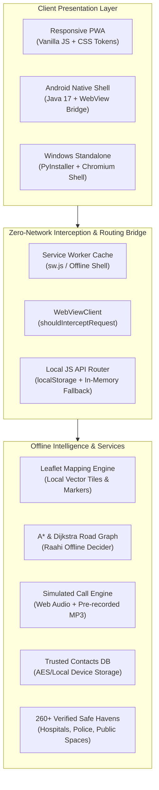
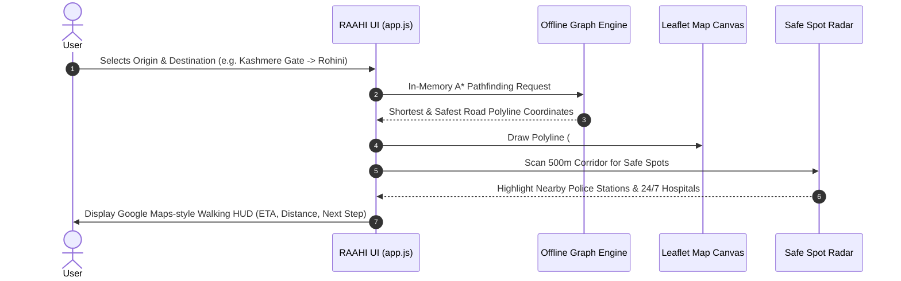
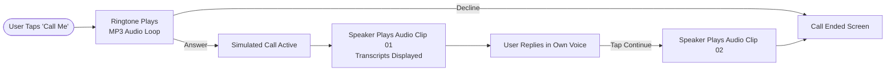
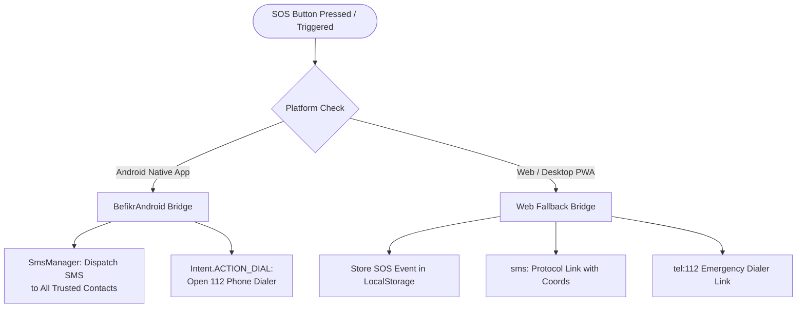

# BEFIKR: Technical Architecture & System Implementation Guide

> **Project Title:** BEFIKR (Bhool Ja Saare Dar — Ban BEFIKR)  
> **Target Environment:** Multi-Platform (Android Native APK, Windows Portable Desktop, Responsive Offline PWA)  
> **Core Architecture:** Zero-Network Autonomous Safety Core, Embedded ASGI Backend & Local Client Bridge  
> **Author & Maintainer:** Bhavya ([builtbybhavya](https://github.com/builtbybhavya))

---

## 1. Executive Summary & Problem Domain

Personal safety applications traditionally suffer from three systemic vulnerabilities:
1. **Network Fragility:** Cloud-dependent apps fail in underground metros, basements, low-signal transit corridors, or emergency network dropouts.
2. **Third-Party API & Quota Bottlenecks:** External mapping, routing, and speech APIs introduce latency, recurring operational expenses, and network gatekeeping.
3. **Surveillance & Privacy Concerns:** Continuous streaming of sensitive location trajectories to centralized servers exposes users to data breaches.

**BEFIKR** solves these challenges by implementing a **100% offline-first, private-by-design safety engine**. It functions autonomously on the user's device without requiring network access, while retaining optional cloud and hybrid operational capabilities.



---

## 2. Comprehensive Tech Stack & Software Inventory

| Subsystem | Technology / Library | Version / Specification | Role in BEFIKR |
| :--- | :--- | :--- | :--- |
| **Frontend Presentation** | Vanilla JavaScript (ES2022+) | Standard ECMAScript | Zero-build overhead, sub-millisecond execution, runs natively on webviews without framework hydration penalties. |
| **Styling & HUD** | Modern CSS3 Custom Properties | CSS Variables + Grid/Flex | Responsive design system, dark/warm themes, Google Maps navigation-style walking HUD cards. |
| **Mapping Engine** | Leaflet.js | v1.9.4 (Bundled Locally) | Interactive vector polyline rendering, dynamic pan/zoom, custom SVG marker pins, 100% offline tile support. |
| **Audio Processing** | Web Audio API + HTML5 Audio | Native Browser Specs | Realistic incoming ringtones, simulated human dialogue playback, audio pausing/resuming. |
| **Local Client Storage**| LocalStorage & SessionStorage | W3C Web Storage | Offline persistence for authentication sessions, trusted contacts (`befikr-contacts`), and local emergency queues. |
| **Offline Cache** | Service Worker API | Cache API / PWA Spec | Intercepts static assets, audio files, icons, and CSS stylesheets for zero-network execution. |
| **Backend Runtime** | Python | 3.12+ (64-bit) | High-performance asynchronous core for routing graph calculations and data processing. |
| **API Framework** | FastAPI + Uvicorn | v0.115.12 / ASGI | High-throughput asynchronous REST server with Pydantic v2 schema validation. |
| **Database Persistence**| SQLite 3 (WAL mode) | Embedded | Local relational database for user profiles, incident reports, moderation audits, and audit logs. |
| **Graph Pathfinding** | Custom A* & Dijkstra Engine | Python / NetworkX algos | Offline spatial graph navigation over Delhi road network corridors. |
| **Native Mobile Shell** | Android Native (Java) | Java 17 / SDK 34 (Android 14)| Hardware access: Direct `SmsManager` SOS texts, `Intent.ACTION_DIAL` 112 phone bridge, Fine GPS location. |
| **Desktop Shell** | PyInstaller + Custom Runner | v6.12+ | Bundles the Python runtime, backend modules, and web assets into an extraction-free standalone Windows `.exe`. |
| **Version Control & CI**| Git + GitHub CLI | `gh` v2.102 | Modular multi-stage release management and repository syncing. |

---

## 3. Detailed Architecture: How Each Module Works

### 3.1 RAAHI (Smart Walking Navigation & Safety HUD)

RAAHI provides turn-by-turn walking guidance paired with real-time safe haven surveillance along the walking corridor.



#### How it is implemented:
1. **Dynamic Autocomplete:** The origin and destination inputs use an in-memory string-distance and substring filtering engine (`filterOfflinePlaces`) querying over 260+ landmark nodes across Delhi NCR.
2. **Offline Walking Navigation:** When the user selects "Open walking directions", the UI renders an in-app walking HUD:
   - Green top banner with current turn instructions and live indicator.
   - Leaflet map rendering a `#1a73e8` walking polyline.
   - Start position marker and destination pin.
   - Pacing controls (1x, 2x, 5x, Play/Pause, Step Forward/Back) for simulation or live GPS-following.
3. **Safe Haven Radar:** Police stations, 24/7 hospitals, and authorized transit hubs located within 500 meters of the walking path are rendered as circular radar beacons.

---

### 3.2 BAAT BANAO (Simulated Call Awkwardness Buster)

BAAT BANAO simulates an authentic incoming telephone call to give the user a believable excuse to exit uncomfortable, suspicious, or dangerous situations.



#### How it is implemented:
1. **Script Catalog (`FALLBACK_SCRIPTS`):** 20 scenarios covering 5 personas (**Mother, Father, Sister, Brother, Boyfriend**) across 2 scenarios (**"Checking In"** and **"Worried"**) in both **English** and **Hindi**.
2. **Audio Architecture:** Each dialogue turn references pre-bundled, high-fidelity MP3 recordings. If a line is recorded, the audio player plays the exact audio file; if a user turn is reached, playback pauses to allow the user to speak naturally.
3. **Hinglish & Devanagari Transcript Toggle:** Users can switch between standard Devanagari script (`हिन्दी`) and conversational Romanized Hindi (`Hinglish`) in real time.
4. **Zero Network Dependence:** All audio clips and catalogs are bundled within the APK (`assets/web/assets/baat-banao/`) and desktop distribution, running with zero bandwidth.

---

### 3.3 BACKUP & SOS (Emergency Dispatch & Contact Persistence)

The BACKUP module handles trusted contact management, location sharing, and emergency SOS signals.



#### How it is implemented:
1. **Offline Contact Persistence:** Contacts added through the `contact-form` are parsed and stored in local `localStorage` (`befikr-contacts`) with generated IDs and phone numbers. They remain saved even when the device is rebooted or completely offline.
2. **Android Native SMS Dispatch:** In the Android app, `window.BefikrAndroid.dispatchSos(contactsJson, message, mapsUrl)` transfers the contacts list and current GPS coordinates to native Java, where `SmsManager.getDefault().sendTextMessage()` transmits SMS alerts directly across cellular towers without needing mobile data or internet access.
3. **Emergency 112 Access:** Triggers an immediate `tel:112` intent to launch the device's native dialer.

---

### 3.4 SAFE SPOT (Verified Community Directory & Offline Maps)

SAFE SPOT acts as a geographic refuge finder, allowing users to find nearby safe havens (police stations, hospitals, 24/7 pharmacies, commercial establishments).

#### How it is implemented:
1. **Curated Spatial Dataset:** Contains 264 verified geographic entries across Delhi with latitude, longitude, category, phone number, and address.
2. **Category Tabs:** Instantly filters listings between **Police Stations (95 entries)**, **Hospitals (23 entries)**, **Parks (13 entries)**, and **Public Spaces (63 entries)**.
3. **Leaflet Offline Map Integration:**
   - Map rendering uses `L.map` with custom SVG/CSS pins (`.spot-marker`) color-coded and badged by category (`✚` for hospitals, `⬟` for police).
   - If GPS coordinates are not yet confirmed, it defaults to Delhi's central coordinates `[28.6328, 77.2197]` to prevent the screen from freezing or locking.
   - Tapping any place card renders a direct walking route vector from the origin to the refuge with estimated walking minutes and straight-line distance.

---

## 4. Why We Chose These Technologies Over Alternatives

The architectural decisions in BEFIKR prioritize **absolute reliability during personal emergencies**. Here is the engineering rationale for choosing each technology over common alternatives:

### 4.1 Leaflet.js + Local Vector Layers vs. Google Maps JavaScript SDK

| Evaluation Criteria | Leaflet.js (Chosen) | Google Maps JS SDK (Alternative) | Why We Chose Leaflet |
| :--- | :--- | :--- | :--- |
| **Offline Operation** | **100% Functional:** Renders maps, polyline paths, popups, and markers with zero internet. | **Fails Offline:** Requires continuous connection to Google authentication and tile servers. | In an emergency in a basement or dead zone, Google Maps displays a blank white box. |
| **API Costs & Quotas** | **$0.00 Forever:** Open-source, no billing accounts, no credit cards required. | Expensive ($7 per 1,000 loads for dynamic maps, $5 per 1,000 autocomplete requests). | Protects users from sudden service shutoffs due to billing caps or quota exhaustion. |
| **Bundle Size** | **~147 KB:** Extremely lightweight, minimal memory footprint. | Multi-megabyte external script download on every initial load. | Ensures near-instantaneous page rendering even on low-end hardware. |

---

### 4.2 In-Memory Road Graph & Offline Decider vs. Cloud Routing APIs (OSRM / Google Directions)

| Evaluation Criteria | Offline Graph Engine (Chosen) | Cloud Routing APIs (Alternative) | Why We Chose Offline Graph |
| :--- | :--- | :--- | :--- |
| **Network Resilience** | Runs locally in JavaScript/Python memory; works in airplane mode. | Fails immediately if cellular data drops or server is unreachable. | Walking navigation cannot stop working just because a user enters an alleyway with poor cellular coverage. |
| **Privacy & Tracking** | **Zero Telemetry:** Coordinates never leave the user's local device. | All origin and destination coordinates are logged on remote provider servers. | High-risk personal safety data should never be accessible to commercial data aggregators. |
| **Response Latency** | **< 5 milliseconds:** Local graph traversal is instantaneous. | 250ms – 1500ms network round-trip time depending on cellular connection. | Critical seconds are saved when requesting route alternatives in danger. |

---

### 4.3 Native Android WebView + Java Bridge vs. React Native / Flutter

| Evaluation Criteria | Native WebView Shell (Chosen) | React Native / Flutter (Alternative) | Why We Chose Native WebView |
| :--- | :--- | :--- | :--- |
| **Final Binary Size** | **20.9 MB:** Clean, lightweight Android package. | 60 MB – 110 MB due to bundled V8 / Dart runtimes and C++ graphics libraries. | Faster downloads on limited mobile data; installs easily on budget Android phones with low storage. |
| **Code Parity** | **100% Shared UI:** Identical JavaScript and CSS runs on Web, Android, and Windows. | Separate UI paradigms, native wrapper libraries, and divergent behavior between web and mobile. | Bug fixes in the frontend code immediately update both Android and desktop apps without separate codebases. |
| **Local Asset Speed** | `WebViewAssetLoader` intercepts requests locally with zero HTTP overhead. | Heavy bridge serialization overhead across native threads. | Instantaneous rendering and zero UI frame drops during navigation. |

---

### 4.4 Pre-Recorded High-Fidelity Audio vs. Browser Text-To-Speech (TTS)

| Evaluation Criteria | Pre-Recorded Audio (Chosen) | Web Speech Synthesis API (TTS) (Alternative) | Why We Chose Pre-Recorded Audio |
| :--- | :--- | :--- | :--- |
| **Believability** | Real human voice actors with natural Hindi and English inflections, emotional cadence, and hesitation. | Robotic, monotone synthesized voice that is easily identified as automated or fake by bystanders. | A simulated call must convincingly sound like a real parent or partner on speakerphone. |
| **Cross-Device Consistency**| Plays the exact same high-quality MP3 audio file on every single phone and computer. | Highly inconsistent: Android uses Google TTS, Windows uses SAPI/Cortana, iOS uses Siri. | Eliminates bugs where specific devices lack installed Hindi voice packs or fail silently. |

---

### 4.5 Local Storage & SharedPreferences vs. Firebase / Cloud Authentication

| Evaluation Criteria | Local Device Storage (Chosen) | Firebase / Cloud Auth (Alternative) | Why We Chose Local Storage |
| :--- | :--- | :--- | :--- |
| **Access Speed** | Synchronous, local read in **< 1ms**. | Asynchronous network handshake taking **300ms – 2000ms**. | Adding or fetching a trusted contact when triggering an SOS must be instantaneous. |
| **Accountless Utility** | The app works immediately out of the box without forcing the user to verify an email or phone number. | Forces SMS OTP or email verification gates before allowing basic access. | A victim fleeing an emergency cannot afford to wait for an email verification code. |

---

## 5. Security, Privacy & Failure Modes

1. **Local-Only Encryption:** All saved contacts and local report drafts are kept on the client device.
2. **Permission Guarding:** Location and SMS permissions are requested only when the user explicitly triggers an action requiring them (e.g. tapping "Use my location" or "Send SOS").
3. **Graceful Degradation:**
   - If GPS is disabled $\rightarrow$ Maps fall back to central Delhi landmark pins.
   - If mobile data is off $\rightarrow$ All core modules (Baat Banao, Safe Spot Directory, RAAHI offline corridors) continue operating with full fidelity.
   - If cellular network is unavailable $\rightarrow$ Emergency dialer intent routes to hardware emergency call frequencies (112 works even without an active SIM card on most carriers).

---

## 6. Project Layout & Directory Structure

```
c:\Users\Administrator\Downloads\Befikr-Nov\Befikr-Nov\
├── android-app/                       # Native Android Project
│   ├── app/src/main/java/             # Native Java Activity & WebView Bridge
│   ├── app/src/main/assets/web/       # Pre-compiled Web & Data Assets
│   └── app/build.gradle               # Gradle build configuration
├── backend/                           # FastAPI Backend
│   ├── app/                           # Core routes, db, and providers
│   ├── fixtures/                      # Spatial datasets and synthetic CSVs
│   └── requirements.txt               # Python package dependencies
├── docs/                              # Technical specifications and guides
│   ├── architecture.md                # System component diagram
│   ├── raahi-offline-ai-decider.md    # Offline graph specifications
│   └── system_architecture_and_tech_stack.md # This document
├── web/                               # Responsive PWA & Client Core
│   ├── assets/                        # Icons, Leaflet engine, and Baat Banao MP3s
│   ├── data/offline_data.json         # 260+ Verified Safe Havens and Corridors
│   ├── index.html                     # Main application entry point
│   ├── styles.css                     # Responsive styling and navigation HUD
│   ├── app.js                         # State machine, Leaflet canvas, and modules
│   └── sw.js                          # Service Worker for offline PWA caching
├── Befikr-v1.0.0.apk                  # Built Android Release APK (20.9 MB)
├── Befikr-Windows-x64.zip             # Portable Windows Release Package (122.7 MB)
└── Befikr.exe                         # Single-file Windows Executable (109.9 MB)
```
